<h1>
  <picture>
    <source media="(prefers-color-scheme: dark)" srcset="docs/brand/crankhog-wordmark-night.svg">
    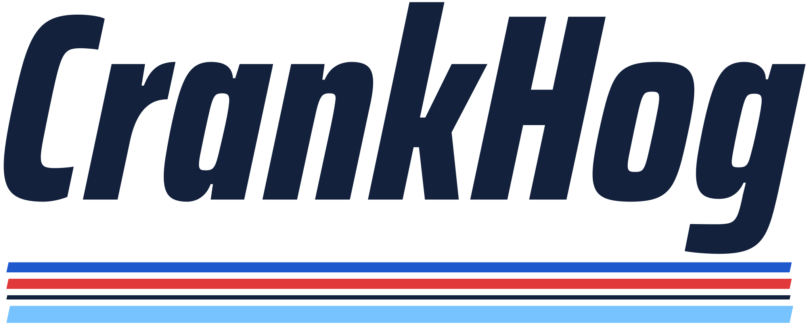
  </picture>
</h1>

**The indoor trainer app that doesn't send you a bill every month.**

You bought the smart trainer. You bought the bike. You turned a corner of the garage into a pain cave, complete with a fan older than your car. Then an app asked for a monthly subscription so you could pedal. In your garage. On the trainer you already paid for. Going nowhere.

CrankHog is free. No subscription, no "Premium" tier, no annual plan with the cancel button hidden four menus deep, and no "your trial has ended" email on the morning of your FTP test. ERG, workouts, FTP tests, routes, the builder, the charts, a training calendar, a plan for your race and a coach who will call you a statue mid-interval, then rewrite your week when you whine about it: all of it, for the grand total of nothing. The only thing it charges is your legs.

It's a data-obsessed indoor cycling trainer for macOS, and [for your phone](#on-your-phone). It drives your smart trainer in ERG, level, slope or heart-rate mode, plays and builds structured workouts, runs an FTP test that actually saves your FTP, rides real routes, and records every second on your Mac as a FIT file. Around the riding, it keeps a training calendar with your runs, swims and squash games next to your rides, builds plans that count back from race day, and, with an AI provider you pick, gives you a coach who rearranges your week when life gets in the way. Your rides stay yours.

<p align="center">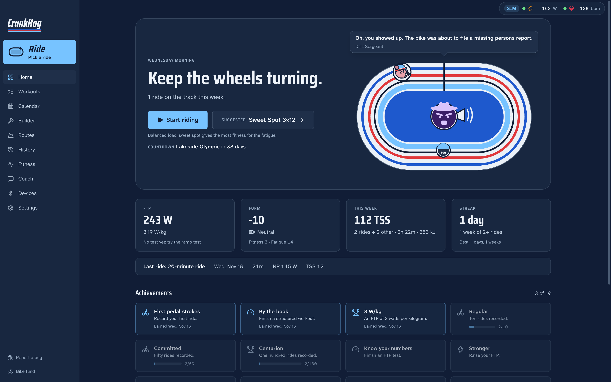</p>

> CrankHog is not affiliated with or endorsed by FulGaz, Zwift, TrainerRoad or Wahoo. Product names are trademarks of their owners.

## A quick tour

**Home is a velodrome.** Every ride this week puts a rider on the boards (with your face, if you add a photo), and harder rides lap faster. Your coach stands in the infield with a megaphone, yelling at you to get on the bike. Haven't ridden yet this week? Another coach is already doing laps, and yours will make sure you hear about it. Under the headline: a workout picked for how tired you are, and a countdown to your next race.

**Pick a ride and go.** One big button, four choices, no forty-tab dashboard to decode before your warm-up.

<p align="center">
  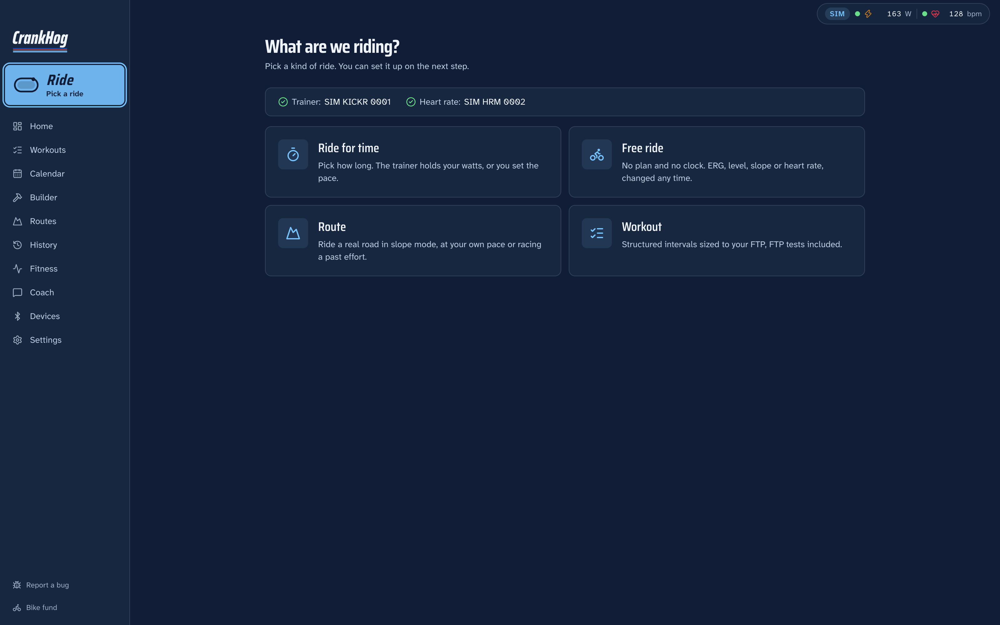
  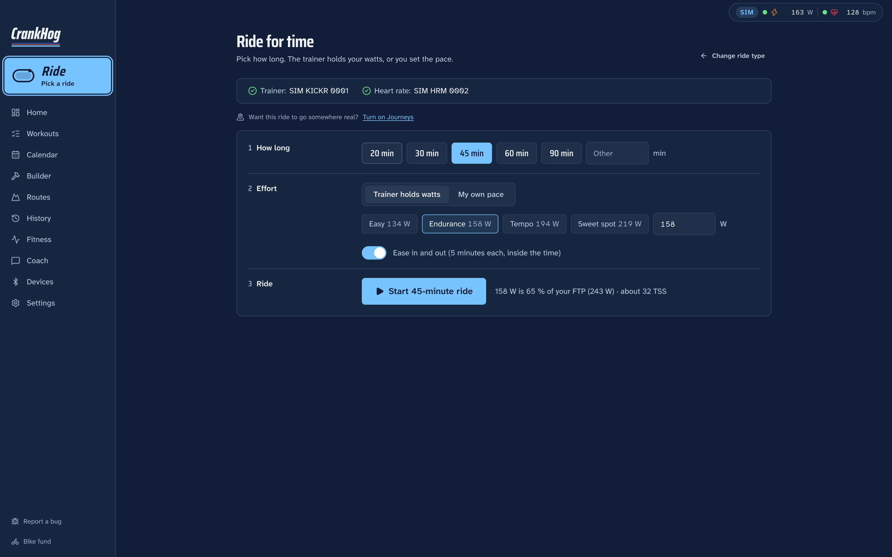
</p>

<p align="center">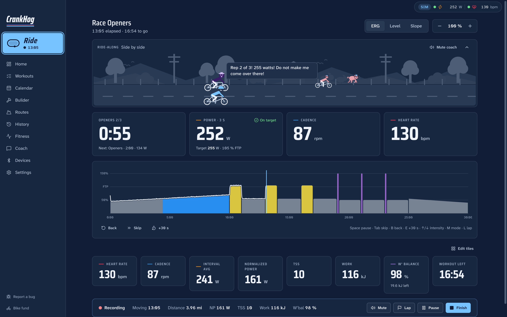</p>

**Your coach rides with you.** They pace at your target. Ease off and they ride away and tell you about it. Push and you drop them, which is the best feeling in indoor cycling.

<p align="center">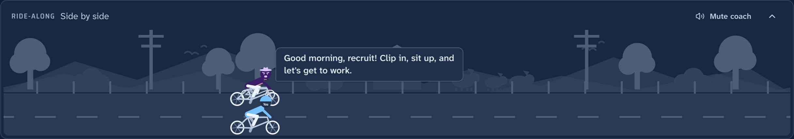</p>

**Twenty-seven coaches, five spice levels, three kinds of language.** From a calm Zen master to a drill sergeant, a screaming thing that lives under your trainer, an angry goose and a LinkedIn guy, plus a run of famous voices doing their best impressions. They're mean on purpose. Or make your own: a name, a photo and a personality, and your AI writes their lines. Profanity goes from Clean to Mild to Unhinged. Unhinged means it.

<p align="center">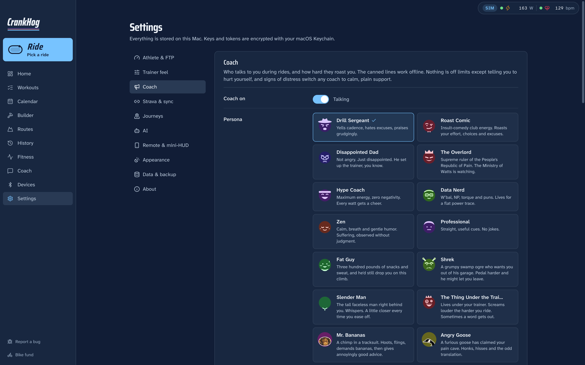</p>

**Then the coach does your admin.** With an AI provider on, tell your coach work is eating you alive and you get a card back: Tuesday's intervals become an easy spin, the swim moves up a day, Friday turns into a travel day. Every change comes with its reason and the session before and after. Nothing moves until you press **Apply**, and **Undo** puts it all back.

<p align="center">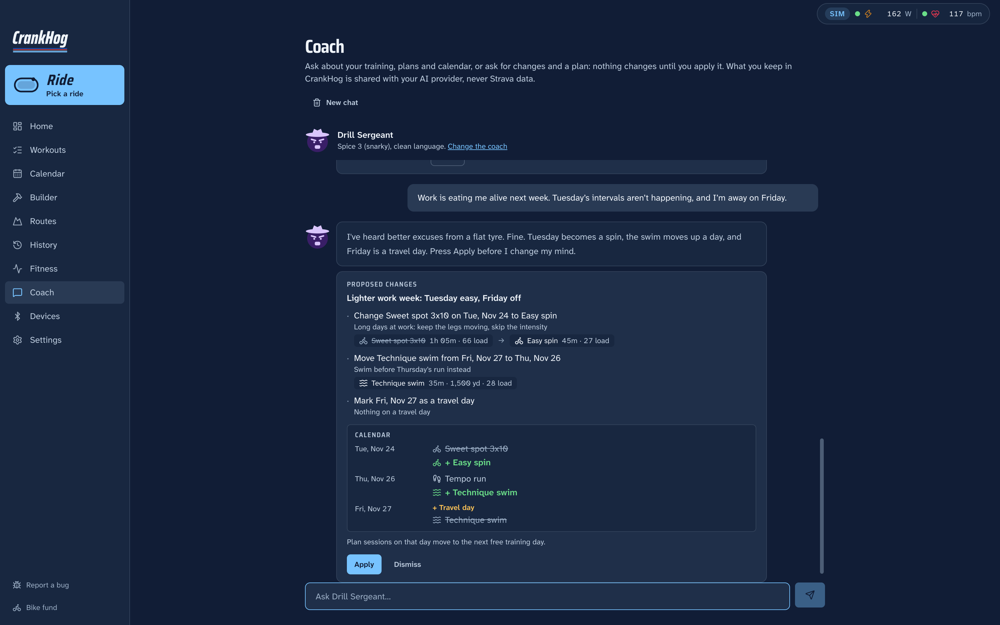</p>

**And writes the whole plan.** Ask for a plan for your race. The coach asks what it needs to know (your days, your hours, your pool, what hurts), then drafts every week: phases and recovery weeks, hours of each sport, and every session with its steps. Say "less swimming" and it rewrites only the weeks that change. Accept it and it lands on your calendar, counted back from race day. Got a plan from a human coach? Drop in the spreadsheet, Word file or PDF, and your AI reads it into sessions you check before anything is saved.

<p align="center">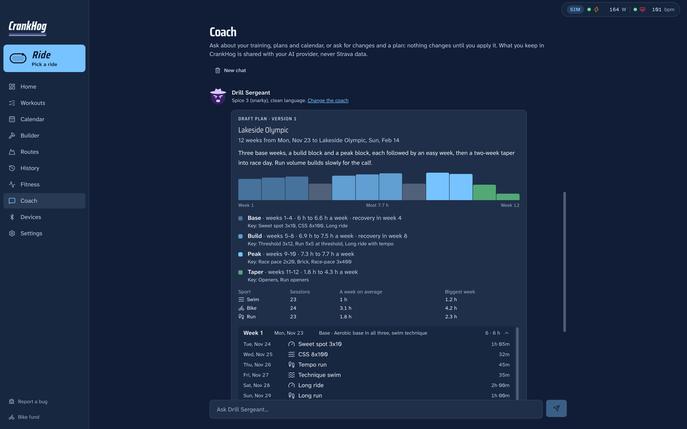</p>

**A calendar for the whole week, not just the rides.** Every planned workout shows its length, load and shape; done turns green and missed turns red. Runs, swims and squash come in from your watch's FIT files or intervals.icu, or you log them by hand, and each week adds up your ride, run, swim and other time against the plan. Drag a session to another day, mark your races and days off, and Google Calendar follows along.

<p align="center">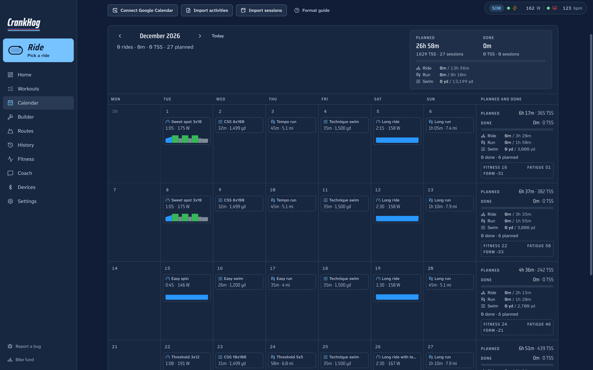</p>

**Workouts you can see before they hurt you.** Bike, Run and Swim each get a tab, and Bike has three shelves: CrankHog's own workouts, your Custom ones, and your Training plans.

<p align="center">
  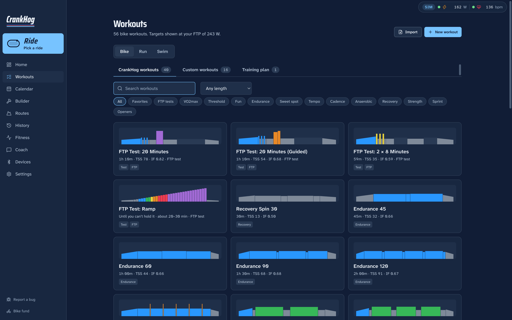
  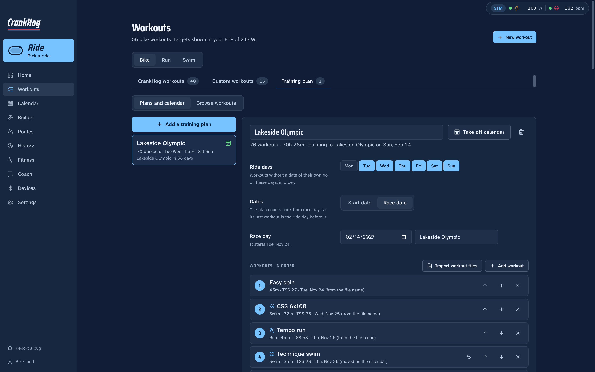
</p>

**And some workouts your old app would never have shipped.** The CrankHog shelf includes eight rude ones, where the power chart is the joke. The Bird is four knuckles at threshold and a middle finger at 150 % FTP. Mount Stupid is the Dunning-Kruger curve. Stairway to Hell has no landing. Liar Liar says "last one" seven times. Sawtooth Motherfucker is exactly what it sounds like. The cues swear, bleeped to match your profanity setting.

<p align="center">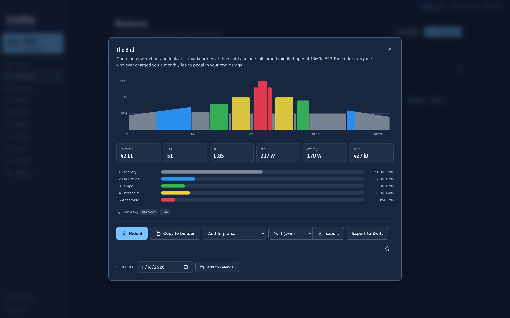</p>

**A builder for the ones nobody has written yet.** Drag blocks, type intervals.icu text, or describe it and let the AI write it. File it under Custom workouts or straight into your plan.

<p align="center">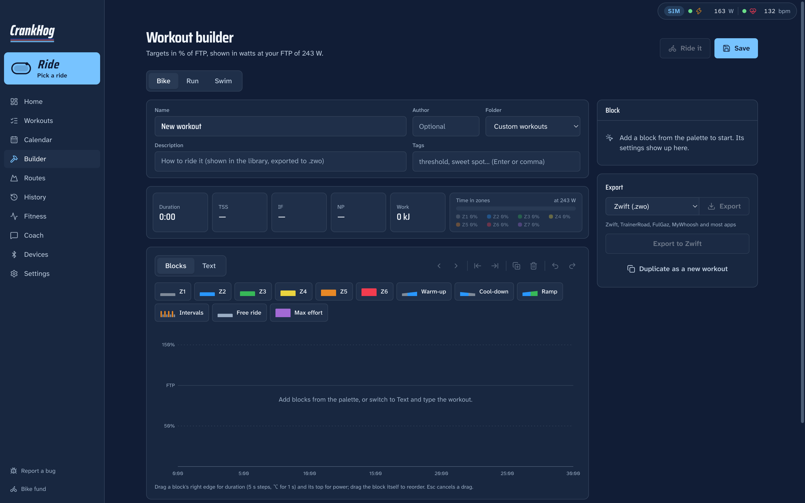</p>

**Runs and swims get a builder too.** Sections and repeats, lengths in time or distance, and targets in heart rate, pace, or a percent of your threshold pace or CSS, with the time and load worked out as you go. Or type it as text and watch it turn into steps.

<p align="center">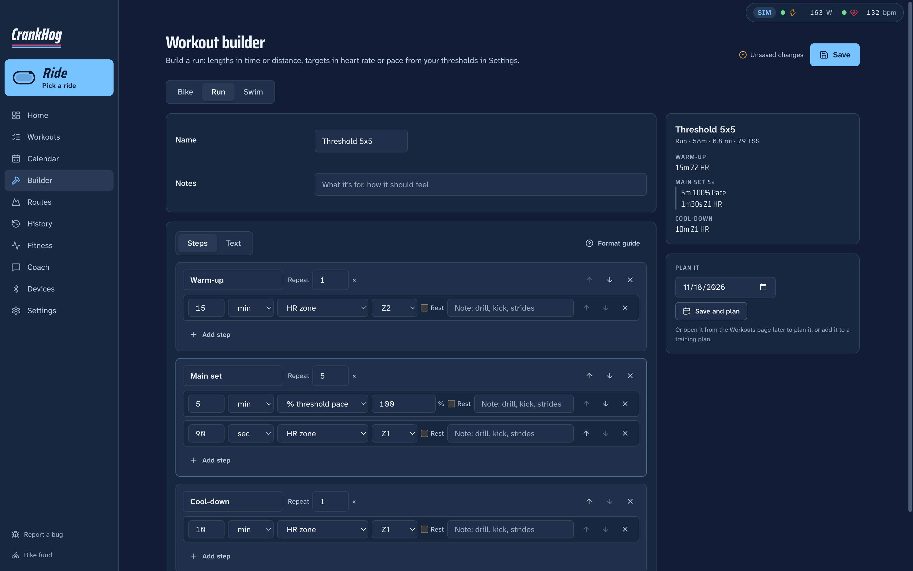</p>

**Real roads, real gradients.** Import a GPX and the trainer climbs when the road does. Race a ghost of your last attempt if you're feeling brave.

<p align="center">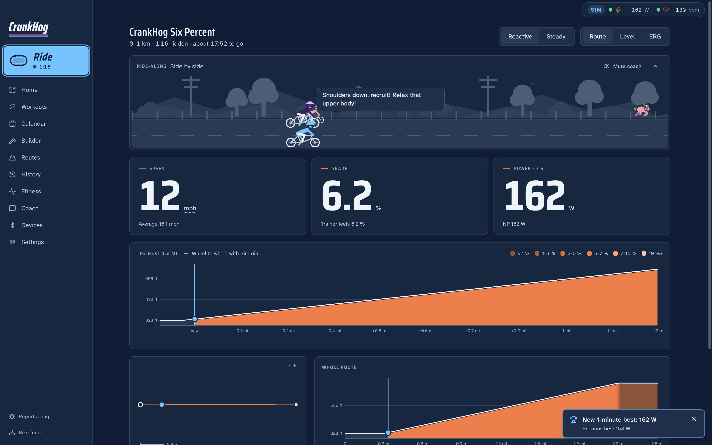</p>

**Go somewhere.** Turn on Journeys and every free ride or workout happens somewhere real. Get dropped at the Eiffel Tower, Shibuya Crossing or the foot of the Stelvio. Or take on a trip that lasts weeks: Land's End to John o' Groats, the Danube, the Pacific Coast, Route 66, coast to coast across America, or Tokyo to Hiroshima. Each ride carries on where the last one stopped. Your watts move a dot along the real road at the speed you'd actually go there, hills included, and the ride lands on Strava with a map. You get towns, state lines and summits along the way, and the coaches have opinions about all of them. The trainer is never touched: it's still your workout, just somewhere better than the garage.

**Light mode, for the sunny garage.**

<p align="center">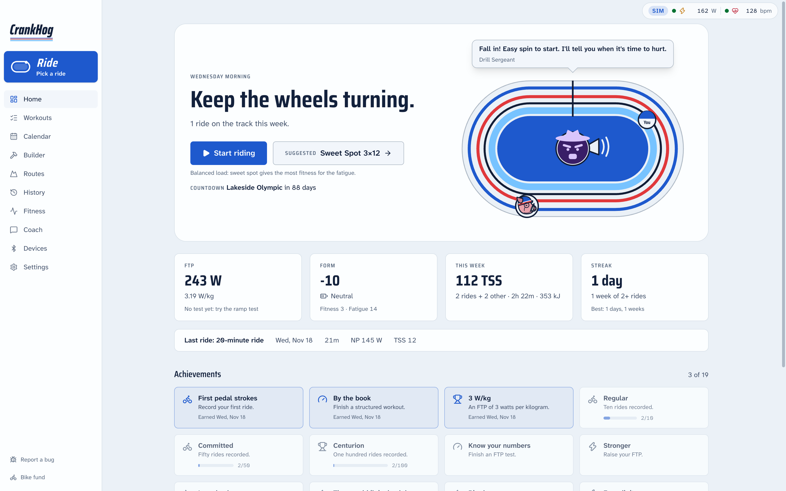</p>

## Everything it does

**Riding**
- **Pick a ride, then go.** The big **Ride** button at the top of the sidebar asks what kind of ride you want, with your trainer and heart-rate status up front:
  - **Ride for time:** 20 to 90 minutes (or any length), with the trainer holding your watts from Easy to Sweet spot, or at your own pace. Ease in and out if you like.
  - **Free ride**, a **route** or a **workout**, each a short list away.
  - While you ride, the button shows your moving time, and a little rider laps the velodrome on it.
- **Just ride.** ERG (the trainer holds the watts), Level (fixed resistance), Slope (a virtual gradient) or HR (the trainer adjusts watts to hold your heart rate). Switch any time with `M`.
- **ERG manners.**
  - A 10-second soft start.
  - A "spiral of death" guard: once you're riding, resistance is released if your cadence collapses below 45 rpm, and comes back once you hold 55. A standing start never trips it.
  - One command per second with deadbands, and targets sent a second early to hide trainer lag.
  - Everything is re-applied after a reconnect.
- **Spin-down calibration.** **Calibrate trainer** on the trainer's card in **Devices** walks you through it: speed up to the speed your trainer asks for, stop pedalling, and let it measure the coast-down. For FTMS trainers that support it. If your trainer asks for one, CrankHog tells you.
- **Journeys** (Settings → Journeys, off by default).
  - **Where to?** on the ride screen: a random famous start, a particular one, the journey you're on, a new grand journey, or any GPX you imported.
  - Distance comes from your power, weight and bike through the same physics as route rides. Real terrain slows you on the climbs; flat is watts to distance only. No power, no progress.
  - A mini map on the ride screen with today's trail, a whole-journey view, and the next town ("Lyon in 41 km"). It draws the road itself, with no map tiles, so nothing leaves your Mac.
  - The FIT file gets the road as GPS, so Strava draws the map. It stays a virtual ride, so you can't take anyone's real-world KOM. The title and description say where you went ("Paris → Rome, day 9: 38.4 km today, 312 of 1421 km"). You can turn the map off.
  - Multi-day journeys keep their progress, celebrate halfway and the finish, and end with a card showing the whole road. Simulated rides never move them.
- **Workouts.**
  - Skip, go back or repeat an interval, and extend one by 30 s.
  - Change the intensity in 1 % steps.
  - Ride any workout in Level or Slope mode instead of ERG.
  - Text cues appear as the workout reaches them, and every interval becomes a lap.
  - Countdown beeps 3, 2 and 1 seconds before each interval ends, and a longer one as the next begins. They keep going when the coach is muted (**Settings → Coach**).
- **Interval rescue.** When a hard interval is failing, it offers 5 % easier or a 30-second breather instead of letting you bail.
- **FTP tests.**
  - **20-minute** (Allen & Coggan). During the effort ERG turns off: the trainer puts you on a 3 % climb (↑/↓ changes it) and a pacing band and projected FTP guide you.
  - **Guided 20-minute**, with the blowout in ERG.
  - **8-minute.**
  - **Ramp.** It ends itself when you can't turn the pedals any more.
  - **Saving the result:** a valid, plausible result is saved automatically, with one-click undo. A drop of more than 3 %, a jump of more than 15 %, or a test with problems asks first. Simulated rides never change your FTP.
- **Routes.** Import GPX or TCX, and the trainer follows the elevation in three modes:
  - **Reactive:** your power drives the speed, through real physics.
  - **Steady:** the recorded pace.
  - **Challenge:** race a ghost of a previous ride.
- **Uphill/downhill scaling** (default 100 % / 50 %, with a 20 % limit) changes only how a climb feels. Speed always uses the true grade.

**Seeing everything**
- **HUD tiles.** Over 40 metrics in tiles you arrange and save per view, with presets:
  - **Power:** 3/10/30 s and interval averages, NP, IF, TSS, W/kg, % FTP, zone.
  - **W′ balance** and **L/R balance.**
  - **Heart rate:** HR zones, % max and % LTHR, decoupling, RMSSD and DFA-α1.
  - **Cadence** against its target band.
  - **Also:** kJ and carbs, time, speed, grade and what was sent to the trainer.
- **Mini-HUD.** An always-on-top panel you can float over Netflix.
- **Phone remote.** Off by default. When on, you scan a QR code; access needs a token and origin checks.
- **Alerts.** Personal-best toasts, and drink and eat reminders.
- **Music.** Spotify or Apple Music controls: `N` next, `Shift+N` previous, `P` play/pause.
- **Light or dark.** Pick in **Settings → Appearance**, or follow macOS. Charts and zone colours have their own validated steps for each theme; the mini-HUD stays dark so it reads over video.
- **Your units.** Metric or imperial, with speed (km/h or mph) and weight (kg or lb) set on their own. Tap the unit on the speed tile to flip it mid-ride.

**Building workouts**
- **Bike, Run and Swim.** Workouts and the builder each have the three. Bike has three shelves: CrankHog's own workouts, your Custom workouts, and your Training plans. Anything you build lands in Custom unless you file it in a plan. Run and Swim hold your runs and swims, to search, plan on a day or add to a plan.
- **Training plan tab.** **Plans and calendar** to build plans and put them on the calendar, or **Browse workouts** to search and filter a plan's workouts, numbered in plan order, and ride any of them.
- **Training plans.** **Add a training plan** asks what you're training for and when, then:
  - **Import your workout files.** They go in in file-name order, and a file named `YYYY-MM-DD_name` goes on that day.
  - **Import a plan document.** A coach's plan as a spreadsheet (.csv, .xlsx, .xls, .ods, .tsv), a Word file, a PDF, or text or Markdown. Your AI provider reads it into sessions: CrankHog says where the document's text is going and sends nothing until you press **Send it and read it**, and nothing else goes with it. No AI? **Download the template**, write one session a row, and it's read on your computer with no AI at all, on the Mac, the web and the iPhone. Either way, the review lists every session by day, sport and length, anything it couldn't read and why, and the race it found, before anything is saved. A race the document names goes on your calendar as an A event, and the plan counts back from it. A scanned PDF is a picture of the page and can't be read.
  - **Build a plan for me.** A few questions (hours a week, the days you ride, your long-ride day, raise FTP, build endurance, or the event, whether all-round, climbing, time trial or criterium), then a week-by-week plan: base, build, specialty and a taper into your event, with a recovery week every fourth week and a ramp test to start. CrankHog builds it from its own workouts, or your AI plans the weeks and writes any workout the library is missing.
  - **Start empty** and pick workouts from your library.

  Or ask the coach for one in the chat, for any sport, triathlon included: see **Coach chat** below.

  A plan is its workouts in order, the days you ride and its dates: a start date, or a race date it counts back from, so its last workout is the ride day before the race. Put it on the calendar, and every change re-lays it; workouts you've ridden stay where they were.
- **A builder like zwofactory.com**, with blocks you can grab:
  - drag a block's edge to change its duration, or its top to change its power;
  - drag a block to reorder it;
  - an inspector for every field;
  - undo and redo;
  - live TSS, IF and zone totals at your FTP.
- **Text mode** uses intervals.icu syntax (`- 10m ramp 40-75%`, `4x`, `- 8m 95-100% 95rpm`), synced both ways with the blocks.
- **Rude workouts included:** The Bird, Both Barrels, Mount Stupid, Stairway to Hell, Shit Show, Sawtooth Motherfucker, Market Crash and Liar Liar, under the Fun filter.
- **Import and export:**
  - `.zwo`, `.mrc`, `.erg` and intervals.icu text;
  - **Export to Zwift** drops the file straight into Zwift's Custom Workouts.
- **Optional AI.** "45 minutes of over-unders, finish with sprints" becomes a workout you can edit.
- **Runs and swims too.** The builder's Run and Swim tabs build sessions step by step: sections and repeats, lengths in time or distance, and targets in heart rate, pace, or a percent of threshold pace or CSS, with the time and load worked out as you go. Or type them in the session format in Text mode.

**Coaching**
- **Twenty-seven coaches**, each with a face (a cartoon, or a talking photo head):
  - Drill Sergeant, Roast Comic, Disappointed Dad, The Overlord, Hype Coach, Data Nerd, Zen and Professional;
  - Fat Guy, Shrek, Slender Man, The Thing Under the Trainer (it screams), Mr. Bananas the chimp, Angry Goose, LinkedIn Guy, The Infomercial Host, The Nature Narrator and Gen Z Intern;
  - parodies of famous voices: **Bibi**, **The Donald**, **Hillary**, **Barack**, **Charlie Kirk**, **Elizabeth Holmes**, **Iron Mike**, **Eric Andre** and **DJ Khaled**.
  - The iPhone app leaves out the parodies of real people, Shrek and Slender Man.
- **Your own coach.** Give them a name, a photo, a description of who they are and, if you like, lines of your own for the moments you pick. With an AI provider on, the AI writes their ride lines from the description and plays them in the coach chat. A master prompt of up to 8,000 characters tells them what to always keep in mind in chats, debriefs and the fitness overview: your race, your injuries, your week, how you like to be coached. **Notes for every coach** in Settings does the same whoever you pick. The same one rule applies.
- **The ride-along.** Your coach bikes next to you on a little road on the ride screen, pacing at your target. Ease off and they ride away; push and you drop them. Their lines pop up in a speech bubble. Fold it to a strip, or turn it off.
- **Caricatures for Bibi and The Donald.** A photo bobblehead on a little bike rides along and talks.
  - Bibi switches between three public photos, The Donald between four. The Donald's long red tie streams in the wind.
  - The head wiggles and the jaw flaps in time with the voice.
  - It stands still if macOS is set to reduce motion.
- **Spice** from 1 (gentle) to 5 (feral).
- **Profanity** in three levels: **Clean**, **Mild** (damn, hell, bloody) and **Unhinged** (as much as the coach can manage).
- **Mute** from the ride screen, or press `C`. Safety prompts still come through.
- **Voice.** Lines are spoken with a macOS voice, and the music is lowered while the coach talks.
- **Coach chat.** With an AI provider on, ask your coach about your training and they answer in character, at your spice and profanity levels.
  - **Ask for changes.** "Move Tuesday's ride to Thursday", "make me a 45-minute workout that hurts", "I'm sick till Friday", "log squash, 1 h, hard", "my FTP is 262 now", "I'm wrecked, lighten next week". The coach proposes, and you get a plain card: what changes and why, each session's time, distance and load before and after, and the calendar before and after. Say how you feel (tired, sore, short on time, fresh) and the coach may suggest changes of its own, as a card too. Nothing happens until you press **Apply**, and **Undo** puts it all back. A workout the coach makes lands in Custom workouts (runs and swims with your sessions), with **Open in the builder**.
  - **Ask for a plan.** "Make me a plan for a full Ironman in 36 weeks." The coach asks about you first: your volume per sport, hours a week, which days and how long, long ride and long run days, pool, injuries, other races, time away. It skips what CrankHog already knows. Then it drafts the plan for you to review: phases with recovery weeks, hours a week of each sport, key sessions, and every session week by week, steps and all. Say what to change ("less swimming", "long ride on Sunday", "I'm away weeks 12 to 13") and it revises. Accept it and every session goes on its day, bike workouts as ERG workouts, the race as an A event, and the plan counts back from the race if it moves. Later changes ("lighten next week") come as cards to apply.
- **Claude Desktop and Claude Code.** Turn on **Claude** in **Settings → AI** and add CrankHog to Claude with one click (Claude Desktop) or one command (Claude Code). Then ask Claude about your training, have it move sessions, write workouts, mark days off or set your FTP, or build a whole plan with you and save it on your calendar. It uses your Claude plan, so CrankHog needs no API key for it. Claude asks before each change, and **Settings → AI** lists every change Claude made, each with **Undo**. Turn off **Claude can make changes** and Claude only reads. CrankHog has to be open; Claude opens it when it needs it.
- **One rule.** No coach ever tells you to hurt yourself. Everything else is fair game, so pick the spice and the language with care. If your heart rate looks wrong, or you stop suddenly in a hard effort, every coach turns supportive.

**Your history**
- **History.** Every ride newest first.
- **The Calendar** (its own page in the sidebar). The whole month: today highlighted, past days greyed, done workouts green and missed ones red.
  - **Moving and planning:** click a day to pick a bike workout, run or swim for it from the same tabs and filters as the Workouts page, drag a planned workout to another day, or bring in what's planned on your intervals.icu calendar.
  - **Google Calendar:** sign in with Google and your planned training shows up as all-day events in a calendar named CrankHog. Move or remove a workout here and Google follows within seconds.
  - **Events and days off:** click a day to mark an event (A, B or C) or a rest, sick or travel day. Plans skip days off and stop before their event, and Home counts down to your next A event.
  - **Other sports:** runs, swims, squash and strength sessions show up too: from your Garmin's FIT files, from intervals.icu, or logged by hand. Squash, the gym and other sports that aren't a run or a swim keep their full time from a FIT file: only the watch's own pauses count as stopped. Importing a file again re-reads it. Each has a load on the same scale as ride TSS (hrTSS from heart rate, intervals.icu's load, or how hard you say it was).
  - **Planning any sport:** click a day to plan a run, a swim or a squash game, or import planned sessions as text files named `YYYY-MM-DD_Name.txt`. The format is in [docs/WORKOUT-FORMAT.md](docs/WORKOUT-FORMAT.md) and the in-app **Format guide**. A planned session turns green when an activity of its sport lands on its day.
  - **Beside each week:** planned against done time, load and sessions, split into Ride, Run, Swim and Other, with fitness, fatigue and form at the week's end, projected from your plan for the weeks ahead. Fitness counts every sport; the power curve and FTP stay rides only.
- **Ride detail:** power, cadence, HR, speed and W′ balance charts, laps, time in zones, RPE and notes, and an AI debrief.
- **Fitness:** the PMC (fitness, fatigue, form), weekly load, the power curve against your 90-day best, and FTP history.
- **Fitness overview.** A plain-English read of those numbers: where your fitness is, the six-week trend, and whether your FTP needs a test. With AI on, your coach writes it, and **Ask the coach** takes it straight into the chat for questions.
- **Home.** The velodrome of this week's rides (or a rival coach doing laps while you don't), your coach shouting from the infield, a suggested workout, your FTP with a retest nudge, form, this week, your latest ride, and achievements and streaks.
- **You.** Add your name and a photo in **Settings → Athlete & FTP** and your own face rides the ride-along bike and laps the velodrome.
- **FIT files:**
  - every ride is saved as a FIT file in `~/Documents/CrankHog/Rides`;
  - import old Garmin or Wahoo FIT files so your fitness charts are complete;
  - rebuild your history from the FIT folder.
- **Backups:** back up and restore everything as a zip.

## Install

Requirements: a Mac with Apple Silicon and Bluetooth.

**From a release:** download `CrankHog-<version>-arm64.dmg` from [Releases](https://github.com/raytfitzgerald/CrankHog/releases) and drag CrankHog to Applications. From 0.4.0, releases are signed with a Developer ID and notarized by Apple, so the first launch only asks the usual "downloaded from the Internet" question. Click **Open**.

<details>
<summary>Releases up to 0.3.0 aren't notarized</summary>

macOS blocks their first launch with "Apple could not verify CrankHog is free of malware". Click **Done** (not Move to Trash), then either:

- open **System Settings → Privacy & Security**, scroll down to the message about CrankHog, click **Open Anyway** and confirm. You only need to do this once; or
- run this in Terminal:

  ```bash
  xattr -dr com.apple.quarantine /Applications/CrankHog.app
  ```

The right-click **Open** shortcut no longer works on macOS 15 (Sequoia) and later.
</details>

**From source** (Node 24+):

```bash
npm install
npm run dev
```

### Updates

From 0.5.0, the Mac app updates itself. It checks GitHub's releases a little after launch and every six hours, downloads a new version in the background, and installs it the next time you quit, or straight away from **Restart to update** in the sidebar. Nothing restarts during a ride. **Settings → About** has **Check for updates**, a switch to turn automatic updates off, and one for pre-releases (test builds published before a release; every release before 1.0 was one). The check only asks GitHub which release is newest; it sends nothing about you or your rides.

0.4.0 and earlier can't update themselves: download 0.5.0 from [crankhog.app](https://crankhog.app) once, and it takes over from there.

### On your phone

CrankHog also runs as an app on your phone, no app store involved: open **[raytfitzgerald.github.io/CrankHog](https://raytfitzgerald.github.io/CrankHog/)** and add it to your home screen. It gets its own icon, opens full screen and works with no signal, which is handy, because the pain cave never has Wi-Fi.

**Android (Chrome).** This is the full experience, trainer included.

1. Open the link in **Chrome**.
2. Tap **⋮ → Add to Home screen → Install**. Chrome may offer an **Install app** banner first, which does the same thing.
3. Open CrankHog from your home screen, go to **More → Devices** and tap **Pair** on the trainer and the heart-rate strap. Chrome asks which device to use. Turn on Bluetooth and Location if it asks: Android needs Location for Bluetooth scanning.

**iPhone and iPad (Safari).**

1. Open the link in **Safari**. Other iPhone browsers can't add a web app to the home screen.
2. Tap **Share** (the square with the arrow), then **Add to Home Screen → Add**.
3. Open CrankHog from your home screen.

Apple doesn't let any iPhone browser use Bluetooth devices, so the iPhone app can't control your trainer or read your strap. Everything else works: the workout library, the builder, history, fitness and the coaches. To ride with the trainer, use the Mac app or an Android phone. To see how a ride looks, open the Devices page and tap *look around with simulated devices*.

**Good to know**

- The phone app keeps its rides in that phone's browser, separate from the Mac app. Use **Settings → Data & backup** to move a backup zip between them.
- AI coaching, Google Calendar and Strava upload need the Mac app, because they keep their keys and tokens on the Mac. On the phone, the coaches use their built-in lines, and a plan document comes in through the template.
- It updates itself: the next time it opens online, it loads the latest version.

## First ride

1. **Free your trainer.** A KICKR accepts several Bluetooth connections but only one controller. Quit Zwift and the Wahoo app, and unpair any head unit that controls it. If something else grabs control, CrankHog says so.
2. **Heart rate from a Garmin watch.** Turn on heart-rate broadcast: on most models it's **Settings → Health & Wellness (or Wrist Heart Rate) → Broadcast Heart Rate**. A chest strap needs no setup.
3. **Connect.** Open **Devices**, then **Connect trainer** and **Connect heart rate**, and pick each from the list. macOS asks for Bluetooth permission the first time. CrankHog remembers your devices and reconnects them at launch.
4. **Tell it about you.** In **Settings → Athlete & FTP**, enter your weight and your FTP if you know it. If you don't, open **Workouts → FTP tests** and take the ramp test (about 20 minutes).
5. **Ride.** Press the big **Ride** button, pick a kind of ride and set it up. Press **Finish** when you're done; the ride is saved, and so is its FIT file.

### Keyboard

| Key | During a ride |
|---|---|
| `Space` | Pause / resume |
| `L` | Lap |
| `↑` / `↓` | Intensity ±1 % (`Shift`: ±5 %); in Level or Slope, harder or easier |
| `Tab` | Skip to the next interval |
| `B` | Back: restart this interval (twice for the previous one) |
| `E` | Extend this interval by 30 s |
| `M` | Cycle trainer mode |
| `C` | Mute the coach |
| `N` / `Shift+N` / `P` | Next / previous track, play / pause music |

## Connecting services (all optional)

**Strava.** Strava only lets each user connect their own API app, and since June 2026 creating one needs a **Strava subscription**.
1. Go to [strava.com/settings/api](https://www.strava.com/settings/api) and create an app. Set **Authorization Callback Domain** to `127.0.0.1`.
2. In CrankHog, open **Settings → Strava & sync**. Paste the app's Client ID and Client Secret, press **Connect**, and approve in your browser.
3. Turn on auto-upload if you like. Rides go up as Virtual Rides and are marked as trainer rides.

CrankHog only uploads. It never reads your Strava data. Without a subscription, use **Strava upload** on any ride: it opens Strava's upload page and shows you the FIT file to drag in.

**Ride moments.** Every ride also saves two pictures next to its FIT file: your hardest 30 seconds, and a coach line picked at random, speech bubble included. They show the ride-along, the big numbers and the workout chart, like the shots Zwift adds to your post. Strava only lets partner apps attach photos, so CrankHog can't add them itself. The saved-ride card has **Copy** and **Open on Strava**, so adding one takes a paste. Turn them off in **Settings → Strava & sync**.

**intervals.icu.** Paste your API key and athlete ID (from intervals.icu → Settings → Developer) in **Settings → Strava & sync**.
- **Completed activities.** Turn on **Completed activities** there, and the runs, swims, squash games and outdoor rides your Garmin records show on the Calendar. They count in weekly volume by sport and in fitness. CrankHog checks at launch and every two hours, and the Calendar has **Refresh activities**.
- **Garmin first.** Connect your Garmin to intervals.icu directly (on intervals.icu: Settings, Connections). Activities intervals.icu got from Strava can't be passed on, and CrankHog still never reads Strava itself.
- **And the AI.** Activities and planned workouts from intervals.icu go to your AI provider with your coach chat, like everything else kept in CrankHog. Nothing from Strava ever does, since intervals.icu never passes Strava activities on.
- **Planned sessions to your watch.** Open a planned run or swim on the Calendar and press **Send to intervals.icu**. intervals.icu reads the steps and puts the workout on your Garmin, if your Garmin connection there allows planned workouts. Moving or removing the session in CrankHog changes it there too. **Import from intervals.icu** brings the runs and swims you plan there onto CrankHog's calendar.

**Google Calendar.** Open **Settings → Strava & sync** and press **Sign in with Google**.
- **What you get.** CrankHog makes a calendar named CrankHog in your Google account and keeps it matching your plan: every planned workout and session from 30 days ago onward, as an all-day event with its length, TSS or load, and notes. A ride's event lists its steps, so a workout the coach changes shows its new steps there too. Runs, swims and other sessions carry their whole `.txt` file, header lines and steps. Add, move, rename or remove one in CrankHog and Google follows within seconds, plans and intervals.icu imports included. Changes made while offline go across the next time CrankHog can reach Google.
- **Only its own calendar.** CrankHog asks for permission to manage calendars it created, nothing else. Your other calendars and events are never read or touched. Events you add to the CrankHog calendar yourself are left alone.
- **CrankHog is the plan.** Drag an event to another day in Google and it goes back to its day in CrankHog. Move it in CrankHog instead.
- **Your own Google app.** Official builds carry CrankHog's own Google app, so you just sign in. A build without it (a local build, or a fork) shows a short setup: make a free Google Cloud project, enable the Calendar API, create a *Desktop app* OAuth client, and paste its client ID and secret.
- **Signing out** revokes CrankHog's access. The CrankHog calendar stays in Google; delete it there if you no longer want it.
- **One calendar per account.** Each Google account you sign in with keeps its own CrankHog calendar, and switching back reuses it. On a new Mac, restore your backup (**Settings → Data & backup**) before signing in and CrankHog carries on with the same calendar. Without the backup it makes a new one, and you can delete the old one in Google.
- **A refused change doesn't hold up the rest.** If Google turns one event down, the others still go across, and Settings says which went wrong.

**Garmin Connect.** Drag a ride's FIT file into Garmin Connect's import page. There is no automatic upload.

**AI.** Open **Settings → AI** and pick one provider:
- **Claude:** an API key from [console.anthropic.com](https://console.anthropic.com). The default model is Claude Opus 5.5.
- **OpenAI:** an API key.
- **Grok (xAI):** an API key from [console.x.ai](https://console.x.ai).
- **Ollama:** runs on your Mac with no key. Install it from [ollama.com](https://ollama.com) and pull a model.

Claude, OpenAI and Grok propose changes and plans with their own tool calls. With Ollama any local model can, though a small one may struggle to write a long plan.

**Claude Desktop and Claude Code** use CrankHog through its add-on rather than an API key: turn on **Claude** under **Settings → AI**, then click **Add to Claude Desktop**, or run the command shown there once in Terminal for Claude Code (it needs Node.js). Only apps running on this Mac under your account can reach it. Claude gets what the coach chat gets: never your name, and never anything from Strava.

Keys are encrypted with your macOS Keychain and never reach the app's UI process.

**What the AI sees.** With each chat message it gets what's kept in CrankHog, fresh: your rides, runs, swims and other sports (activities from intervals.icu included), your plans and the week you're in, the calendar from four weeks back to up to twelve ahead, races, days off, and your custom coach's master prompt and your notes for every coach. A ride debrief gets that ride, and the fitness overview your fitness numbers, each with the master prompt and notes. A plan document goes only when you import one, on its own. Your name never leaves your Mac, and nothing from Strava ever goes to the AI.

## Your data

Everything stays on this Mac. Rides live in the app's database, plus a FIT file per ride in `~/Documents/CrankHog/Rides`; you can change that folder, for example to one in iCloud Drive for free sync. **Settings → Data & backup** saves or restores a full backup zip, or scans the FIT folder to rebuild your history on a new Mac. Nothing leaves the machine unless you connect Strava, intervals.icu or Google Calendar, turn on an AI provider, let Claude use CrankHog, or send a bug report. Google Calendar gets only the name, day and description of each planned session. Your AI provider gets what's listed under [What the AI sees](#connecting-services-all-optional), and never your name or anything from Strava. The update check asks GitHub for the newest release and sends no data of yours.

## Reporting a bug

Use **Report a bug** at the bottom of the sidebar (or **Settings → About**). It opens a GitHub issue with your report and a few diagnostics filled in: app and macOS versions, device types and a few settings, never names or ride data. You can read and edit all of it before you submit. You can also [open an issue](https://github.com/raytfitzgerald/CrankHog/issues/new/choose) directly.

## Building from source

| Command | What it does |
|---|---|
| `npm run dev` | Launch the app with hot reload (the main process restarts on its own changes) |
| `npm run dev:web` | Run the UI alone in a browser with simulated devices (no Electron) |
| `npm run check` | Typecheck + lint (with architecture boundaries) + unit and simulator tests |
| `npm run e2e` | Build, then run the Playwright Electron end-to-end suite |
| `npm run dist` | Build `release/<version>/CrankHog-<version>-arm64.dmg` |
| `npm run dist:signed` | The same DMG, signed with a Developer ID, notarized and stapled (see below) |
| `npm run selftest:packaged` | Boot the packaged app and round-trip one IPC call |
| `npm run licenses` | Verify every shipped dependency is MIT-compatible |
| `npm run icon` | Re-render the app icon |

To try it without hardware, `CRANKHOG_SIM=1 npm run dev` runs the app against a simulated KICKR and HR strap that speak real Bluetooth bytes. Add `CRANKHOG_WARP=10` to speed up time ten-fold; simulated and time-warped rides are always flagged, and never count towards Strava, fitness or FTP.

Ad-hoc signatures change on every build, so macOS forgets permission grants such as Bluetooth and Automation. To keep them, create a self-signed "Code Signing" certificate named `CrankHog Local` in Keychain Access and build with `CSC_NAME="CrankHog Local" npm run dist`.

### Releasing a signed build

`npm run dist` makes an ad-hoc signed DMG, which macOS blocks on first launch. `npm run dist:signed` makes the same DMG signed with a Developer ID, with the hardened runtime, notarized by Apple and stapled, so it opens with only the usual "downloaded from the Internet" prompt. It needs a paid Apple Developer Program membership, and three things set up once per Mac:

1. **A Developer ID Application certificate** in your login keychain. Create it at [developer.apple.com → Certificates](https://developer.apple.com/account/resources/certificates/add) from a certificate request made in Keychain Access. Without Xcode, also install Apple's [Developer ID G2 intermediate](https://www.apple.com/certificateauthority/DeveloperIDG2CA.cer), or the certificate shows as not valid. `security find-identity -v -p codesigning` should list it.
2. **Notarization credentials** in a keychain profile named `crankhog` (set `CRANKHOG_NOTARY_PROFILE` to use another name). Make an app-specific password at [account.apple.com](https://account.apple.com), then run:

   ```bash
   xcrun notarytool store-credentials crankhog --apple-id YOUR_APPLE_ID --team-id YOUR_TEAM_ID
   ```
3. **CrankHog's Google app** (the client ID and secret riders sign in to Google Calendar with) in the keychain. Each command asks for the value, so it stays out of your shell history:

   ```bash
   security add-generic-password -U -s crankhog-google -a client-id -w
   ```

   ```bash
   security add-generic-password -U -s crankhog-google -a client-secret -w
   ```

   `CRANKHOG_GOOGLE_CLIENT_ID` and `CRANKHOG_GOOGLE_CLIENT_SECRET` override them. Without the app, the DMG would send every rider off to make their own Google Cloud project, so the script refuses to build, and it checks the built app really carries it.

The script checks all three before it builds. Then it signs, notarizes and staples the app and the DMG, builds the zip and `latest-mac.yml` that the in-app updater installs from, and runs `spctl` the way Gatekeeper will. Notarization usually takes a few minutes. CI keeps building the ad-hoc DMG, because the certificate never leaves your Mac. To release:

1. Merge the version bump and push the tag (`v0.5.0`). CI creates the GitHub release with its ad-hoc DMG. The bump carries the full notes in `docs/releases/v0.5.0.md` (CI puts them on the release) and a short entry in `src/core/whats-new/notes.ts`, which riders see once after the update; a test fails a bump without one.
2. Run `npm run dist:signed -- --upload`. It replaces CI's DMG with the signed one and attaches the zip, its blockmap and `latest-mac.yml`. Once `latest-mac.yml` is on the release, installed copies (0.5.0 and later) find the update within six hours, or right away from **Settings → About → Check for updates**.

If signing fails with "A timestamp was expected but was not found", `codesign` can't reach Apple's timestamp server. On some home routers that happens only over IPv6. Turn IPv6 off for the build (`sudo networksetup -setv6off Wi-Fi`, then `-setv6automatic Wi-Fi` afterwards) and run it again.

The first signed build is a new code identity, so macOS asks once more for Bluetooth, and once to let CrankHog read "CrankHog Safe Storage" in the keychain (choose **Always Allow**). Rides, settings and saved keys carry over.

### Architecture

- `src/core`: pure TypeScript domain logic, with no DOM, Node or Electron; ESLint and a dedicated tsconfig enforce that. It holds:
  - BLE codecs and drivers, the simulator, trainer control and PowerMatch;
  - workouts, routes, ride recording, metrics, physics and FIT;
  - the coaching engine.
- `src/main`: the Electron main process. It owns:
  - windows and the Bluetooth device chooser;
  - the crash-safe ride journal and files;
  - secrets (macOS Keychain via `safeStorage`);
  - Strava and intervals.icu, AI, music, and the phone remote.
- `src/preload`: a small bridge that exposes `window.crankhog` (typed `invoke` / `on`) for allowlisted channels only.
- `src/renderer`: the React UI and the ride engine. Web Bluetooth lives here.
- `src/shared`: the zod-validated IPC contract that everything above agrees on.

Security defaults:
- `contextIsolation`, `sandbox`, and no `nodeIntegration`;
- a strict CSP and the `app://freegaz` origin;
- a sender check on every IPC call;
- hardened Electron fuses.

## Brand

CrankHog looks like a velodrome: Stayer Blue, midnight boards, four painted lines, and square race-number digits. The colours, type, logo and voice are in [docs/BRAND.md](docs/BRAND.md), and the logo files are in [docs/brand/](docs/brand/).

## License

[MIT](LICENSE). CI checks every shipped dependency for MIT compatibility. Garmin's FIT SDK is used only in the test suite, as a reference decoder, because its license forbids redistribution. The built-in workouts and every coaching line are original.

The journey roads in [`src/renderer/src/journeys/data`](src/renderer/src/journeys/data/LICENSE.md) are © OpenStreetMap contributors under the Open Database License, routed with BRouter, with NASA SRTM elevation (public domain).

The typefaces, Saira and Atkinson Hyperlegible Next, are under the SIL Open Font License 1.1. The caricature photos are not covered by the MIT license: five are U.S. government works in the public domain, and one is under the Government Open Data License – India. Credits, sources and a list of changes are in [`src/renderer/src/coach/toon/heads/ATTRIBUTION.md`](src/renderer/src/coach/toon/heads/ATTRIBUTION.md). The India photo is courtesy of the Prime Minister's Office and the Press Information Bureau, Government of India.
